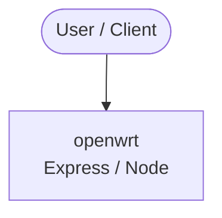

# Context Map — `openwrt`

> Auto-generated architecture & deployment context map. Summarizes the core application, container/cloud footprint, and database connections. Regenerate after significant structural changes.

**Repo:** `avnit/openwrt` · **Fork** · Public · Primary language: C · Default branch: `main` · Files: 11384

**Description:** This repository is a mirror of https://git.openwrt.org/openwrt/openwrt.git It is for reference only and is not active for check-ins.  We will continue to accept Pull Requests here. They will be merged via staging trees then into openwrt.git.

## 1. Core application

OpenWrt Project is a Linux operating system targeting embedded devices. Instead

- **Frameworks / runtime:** Express / Node
- **Listens on port(s):** 22, 1035, 1508, 1723, 1812, 1813

## 2. Containers & cloud applications

**Containers:**
- `.devcontainer/ci-env/devcontainer.json`

## 3. Database connections

_No database drivers or connection strings detected._

**Environment / config files:** `package/boot/uboot-microchipsw/src/board/microchip/lan969x/lan969x.env`

> ⚠️ Non-template env files are committed: `package/boot/uboot-microchipsw/src/board/microchip/lan969x/lan969x.env`. Verify no live secrets are tracked.

## 4. Architecture diagram

## 5. Security posture

- **Static scan findings:** 6 high, 14 medium

| Severity | Rule | File:Line |
|---|---|---|
| high | generic-secret-assign | `package/network/ipv6/6in4/files/6in4.sh:118` |
| high | generic-secret-assign | `package/network/ipv6/6in4/files/6in4.sh:144` |
| high | generic-secret-assign | `package/network/services/hostapd/patches/140-tests-Makefile-make-run-tests-with-CONFIG_TLS.patch:1042` |
| high | generic-secret-assign | `package/network/services/hostapd/patches/140-tests-Makefile-make-run-tests-with-CONFIG_TLS.patch:1044` |
| high | tls-verify-disabled | `scripts/dl_github_archive.py:407` |
| high | generic-secret-assign | `scripts/flashing/jungo-image.py:44` |
| medium | weak-hash | `package/base-files/files/usr/libexec/duid-generate:90` |
| medium | weak-hash | `package/network/config/wifi-scripts/files-ucode/usr/share/ucode/wifi/ap.uc:190` |

---
_Generated by repo context-mapping pass on 2026-08-13._